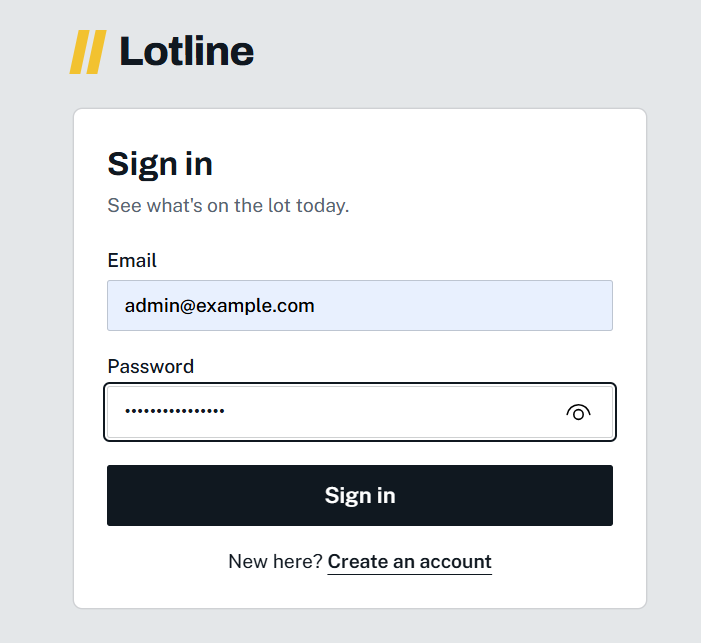
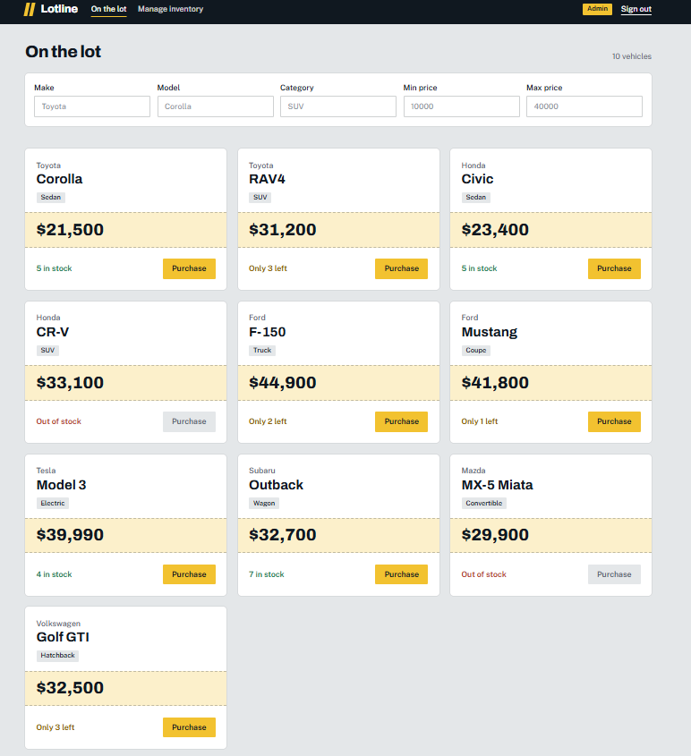
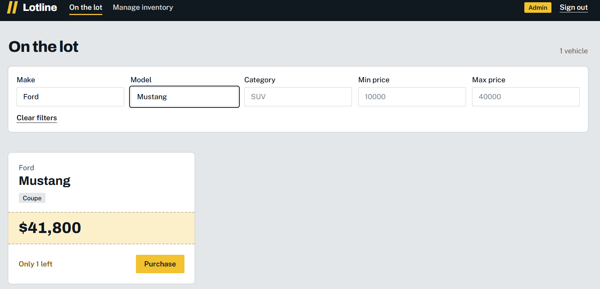
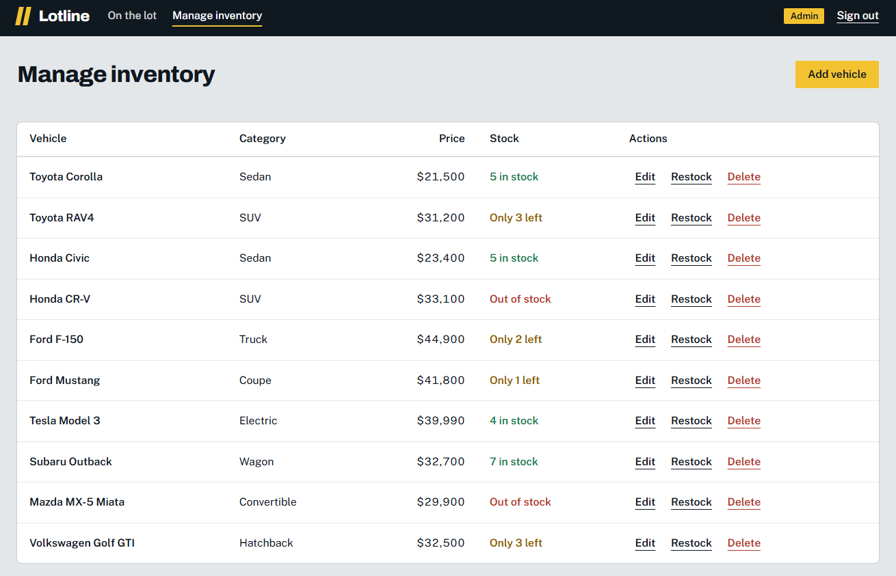
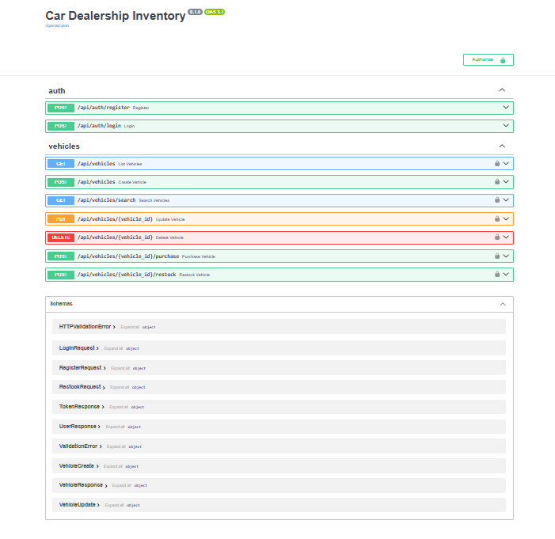
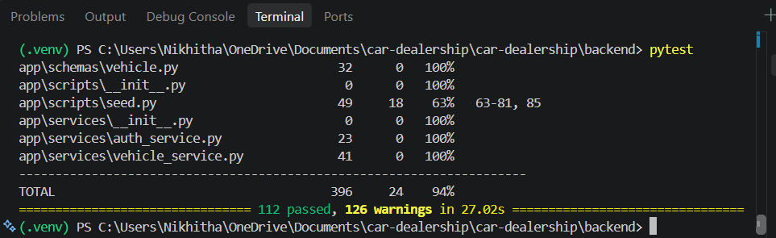
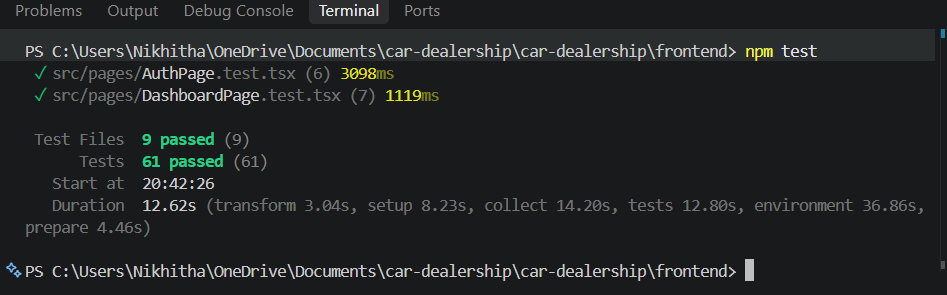

# Lotline: Car Dealership Inventory System

A full-stack inventory app for a car dealership, built test-first as an AI-assisted TDD kata.
Staff and customers can browse, search and buy vehicles. Admins can add, edit, restock and delete them.

**Stack:** FastAPI · PostgreSQL · SQLAlchemy · JWT auth · React · TypeScript · Tailwind CSS · Docker

## Screenshots

| Sign in | Dashboard |
|---|---|
|  |  |

| Search and filters | Manage inventory (admin) |
|---|---|
|  |  |

**API documentation (Swagger UI at `/docs`)**



## Features

- **Accounts:** register and sign in with email and password. Passwords are hashed with bcrypt and sessions use signed JWTs.
- **Browse and search:** filter the lot by make, model, category and price range. Text filters are case-insensitive partial matches, and price limits are inclusive.
- **Purchase:** buy one unit of a vehicle. The Purchase button is disabled when stock is zero, and a purchase can never push stock below zero.
- **Admin tools:** a *Manage inventory* page to add, edit, restock and delete vehicles, with validation and a confirmation step before deleting.
- **Roles:** everyone registers as a regular user. Admins are created with a seed script, so nobody can promote themselves.

## How it fits together

```
React (Vite)  ──HTTP/JSON──▶  FastAPI routers  ──▶  Services  ──▶  Repositories  ──▶  PostgreSQL
 localhost:5173                 /api/...             business        SQLAlchemy         (Docker)
                                                     rules
```

- **Routers** handle HTTP only: parsing, status codes, auth dependencies.
- **Services** hold the business rules (for example "out of stock") and know nothing about HTTP or SQL.
- **Repositories** are the only code that talks to the database.

Because of that split, the business rules are unit-tested with fake repositories, while the API is tested end to end against a real (SQLite) database.

## Getting started

### Prerequisites
Docker Desktop, Node.js 20+, and (for running backend tests outside Docker) Python 3.12.

### 1. Start the database and API
```bash
cp .env.example .env            # then set SECRET_KEY to a long random string
docker compose up --build       # API at http://localhost:8000, docs at /docs
```

### 2. Create an admin and demo data
In a second terminal, from the project root:
```bash
docker compose exec backend python -m app.scripts.seed --admin-email admin@example.com --admin-password "change-me-please" --demo
```
This creates the admin account and adds 10 sample vehicles (including two out of stock).

### 3. Start the website
```bash
cd frontend
npm install
npm run dev                     # http://localhost:5173
```
Sign in with the admin email and password above. Register a second account to see the regular-user view.

## API reference

| Method | Path | Who | Purpose |
|---|---|---|---|
| POST | `/api/auth/register` | public | Create a regular user |
| POST | `/api/auth/login` | public | Get a bearer token |
| GET | `/api/vehicles` | signed in | List all vehicles, including out of stock |
| GET | `/api/vehicles/search` | signed in | Filter by `make`, `model`, `category`, `min_price`, `max_price` |
| POST | `/api/vehicles` | signed in | Add a vehicle |
| PUT | `/api/vehicles/{id}` | signed in | Update fields (partial update) |
| DELETE | `/api/vehicles/{id}` | **admin** | Delete a vehicle |
| POST | `/api/vehicles/{id}/purchase` | signed in | Buy one unit (409 if out of stock) |
| POST | `/api/vehicles/{id}/restock` | **admin** | Add units (`{"quantity": n}`) |

Status codes: `401` not signed in · `403` not an admin · `404` not found · `409` out of stock or duplicate email · `422` invalid input.
Send the token as `Authorization: Bearer <token>`.

## Tests

```bash
# Backend (from backend/, with the virtualenv active)
pip install -r requirements-dev.txt
pytest

# Frontend (from frontend/)
npm install
npm test
```

### Test report

| Suite | Result |
|---|---|
| Backend (pytest) | **112 passed**, 94% line coverage |
| Frontend (Vitest + Testing Library) | **61 passed** across 9 test files |

```
Backend:   112 passed, 126 warnings in 27.02s     (TOTAL coverage 94%)
Frontend:  Test Files  9 passed (9)
                Tests  61 passed (61)
```




The warnings are library deprecation notices, not failures. The least-covered file is the seed script's command-line wrapper (63%).

## Design decisions

- **No overselling.** A purchase is one guarded SQL statement (`UPDATE ... SET quantity = quantity - 1 WHERE id = ? AND quantity > 0`), not "read, check, write". Two buyers racing for the last car cannot both succeed. A database check constraint also forbids negative stock, and tests cover both.
- **Roles are read from the database,** not trusted from the token, so changing a user's role takes effect immediately.
- **Server-side authorization.** The UI hides admin screens from regular users for convenience, but the API enforces every rule itself.
- **No account enumeration.** Login returns the identical error for an unknown email and a wrong password.
- **403 before 404 on admin routes,** so regular users cannot probe which vehicle IDs exist.
- **Partial updates.** `PUT /api/vehicles/{id}` accepts any subset of fields. A strict full replacement would be a small change.
- **Out-of-stock vehicles stay visible** in lists and search, so the UI can show them as sold out.
- **Money** is stored as `Numeric(10, 2)`, not floating point.

## Project structure

```
backend/
  app/
    api/           routers and auth dependencies
    services/      business rules
    repositories/  database access
    models/        SQLAlchemy tables
    schemas/       request and response models
    core/          config, security, database
    scripts/       admin and demo-data seeding
  tests/           unit/ and integration/
frontend/
  src/
    api/ auth/ components/ pages/ hooks/ lib/ test/
docker-compose.yml
```

## How it was built (TDD)

Features were built in slices, tests first: security helpers, then registration and login, then vehicle create and list, search, update and delete, and finally purchase and restock. The frontend followed the same approach.
See the Git history for the sequence of `test:` and `feat:` commits.

## My AI Usage

>## AI Tool Usage and Reflection

### Tools Used
Claude (Anthropic), accessed through the Claude mobile app.

### How I Used AI
I used Claude as a development assistant throughout the implementation of my Car Dealership Inventory System. It helped me plan the application architecture, including the layers, data model, API endpoint rules, and the order of development using Test-Driven Development (TDD). I also used it to generate tests and corresponding implementations for individual features, build the React frontend, prepare the Docker configuration and seed script, and draft the initial README. Additionally, I used Claude to troubleshoot local development issues involving the Windows terminal, Docker Desktop, and Git by sharing screenshots of errors.

### What I Did Myself
I was responsible for setting up and working with the project in my local development environment. I reviewed the generated code and tests, followed the implementation steps, and ran the test suites to verify the application's behaviour. I also worked through the setup and troubleshooting process, managed the project using Git, and prepared the project for assessment.


### What I Checked and What I Found
I ran both test suites in my local environment. All **112 backend tests and 61 frontend tests passed**, giving a total of 173 passing tests. This helped me verify that the implemented functionality behaved as expected under the tested scenarios.


### Limitations and Transparency
Claude generated the tests and their corresponding implementations during each development stage. Although I organised the commits in the intended sequence of tests followed by implementation, I did not independently observe each test failing before writing the corresponding code. Therefore, the commit history represents the intended TDD workflow rather than a complete record of the traditional red-green-refactor cycle. Claude could not execute the project in my local environment, so I performed the first actual test run myself.

### Reflection
Using AI helped me organise the development process, understand the project structure, and resolve setup issues more efficiently. Running the test suites myself was important because it allowed me to verify the results in my own environment rather than relying only on AI-generated code. I also learned that following a test-first commit sequence is not the same as practising TDD fully; observing a test fail before implementing a solution is an important part of the process. In future projects, I would use AI for guidance and repetitive tasks while writing or reviewing tests independently, checking edge cases, and ensuring I understand each implementation before accepting it.

The full chat logs are in [`PROMPTS.md`](PROMPTS.md).

## Known limitations and next steps

- Tables are created on startup. A real deployment should use database migrations (Alembic).
- The sign-in token is kept in `localStorage`, which is simple but readable by any injected script. An HTTP-only cookie would be safer.
- Any signed-in user can add and edit vehicles through the API; only the admin screens are restricted in the UI. Locking this to admins would be a small change.
- Purchases buy one unit at a time and have no payment or order history.
- The frontend is run with `npm run dev`; it is not part of `docker-compose.yml`.
